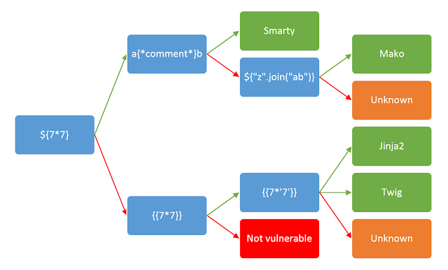

## Bản chất và khái niệm

Lỗi xảy ra khi input người dùng truyền vào template phía server xử lý như 1 phần cú pháp của template  Template thực thi input đó  gẫy lỗi hoặc làm lộ dữ liệu, đọc file nhạy cảm, RCE trên server.

Để test SSTI, trước hết ta sẽ test `${{<%[%'"}}%\`, mỗi template engine sẽ dùng cú pháp khác nhau, nếu như kí tự nào gây lỗi thì có thể là dấu hiệu template engine hoạt động ở đây, ngược lại thì chúng sẽ được hiển thị bình thường hoặc escape bỏ.

Trong code plaintext, có thể chưa xác định được vấn đề sẽ xảy ra ở input ta truyền vào, input sẽ được nhét vào bên trong 1 template có sẵn. Vì vậy, phải test xem input truyền vào có thật sự được xử lý không, ví dụ như truyền `…?greeting=abc<tag>`, response trả về sẽ là lỗi/exception hoặc rỗng. Khi thử truyền `…?greeting=abc}}tag` output xuất hiện có cả thẻ `<tag>` thì có thể xác định output thoát khỏi code context của template  khả năng rất cao có SSTI.

Để test xem template Engine phía sau là loại nào, có thể xem cách response trả về vì mỗi template engine có cách xử lý dữ liệu khác nhau.

*Hình 1. Các template engine cơ bản có lỗi SSTI*

## Cách khai thác

Sau khi xác nhận có SSTI và biết được template engine ta sẽ cần làm 3 bước:

### Read

đọc tài liệu của template engine. Ta cần đọc tài liệu để biết syntax, cách truy cập biến, các hàm/object được expose khác nhau.

### Explore the environment

tìm hiểu môi trường mà template đang chạy. Có thể môi trường là sandbox chỉ thực thi được một số lệnh như đọc biến, loop, format string trong khi có môi trường unsandboxed có thể gọi OS command, import module hệ thống hay truy cập filesystem.

### Create a custom attack

dựa trên những gì đã biết để xây dựng cách khai thác phù hợp, dựa vào ngay syntax, hay CVE về template engine phiên bản đó, etc.

Tùy thuộc vào code context mà ta có thể thử payload để chạy các lệnh system, cần phải test để hiểu mã nguồn được viết như nào, syntax sao cho phù hợp, nếu như cứ ghi payload theo hướng dẫn thì có thể gây lỗi vì luồng chưa được đóng đúng cách.

Ví dụ: `blog-post-author-display=user.name`, khi ta truyền payload `{{7*7}}` thay vì user.name thì payload vẫn hoạt động và trả về response `{{49}}`, nhưng khi ta truyền lời gọi hệ thống trong tornado thì kết quả trả về bị lỗi, từ đó có thể đoán được trong query parameter có mã nguồn dạng như `blog-post-author-display = {{…}}`.

Vì vậy để có thể import hàm os cũng như thực thi các lệnh liên quan đến system, ta cần phải đóng biểu thức ban đầu `{{` trước sau đó mới truyền payload, phía sau cũng không cần `}}` vì mã nguồn ban đầu đã có sẵn.

Nếu như đọc documentation mà vẫn chưa tìm được payload phù hợp, ta cần chuyển hướng sang khai thác các đối tượng đặc biệt của môi trường như: self, environment, context, model, data_model. Chúng đặc biệt ở chỗ có thể chứa biến, hàm, phương thức, thuộc tính, đối tượng do ứng dụng truyền vào template.

Ví dụ: ` ${T(java.lang.System).getenv()}` sẽ gọi system.getenv() để lấy các biến môi trường của ứng dụng. Để sử dụng tự động  Burp Intruder để thử và quan sát response trả về.

Nếu như engine chặn import, không cho gọi runtime, giới hạn class truy cập, chạy trong sandbox ta cần tạo 1 object chain: object  method/property  object khác  method nguy hiểm.

## Notes

Test xem payload engin nào, truy cập link github này https://github.com/gunyakit/command-cheatsheet/blob/main/7.Web-Exploit/7.6.SSTI.md#tornado-python.

Đối với template engine ERB của Ruby, khi audit SSTI cần chú ý đến các đối tượng nguy hiểm như: File, Dir, IO, Open3, system, exec,etc.

Đối với FreeMaker (Java), new() là một hàm nguy hiểm vì nó cho phép template tạo đối tượng Java. freemarker.template.utility.Execute có khả năng nhận một chuỗi lệnh và thực thi lệnh shell trên server vì vậy khi kết hợp cả hai sẽ tạo ra payload khởi tạo 1 đối tượng mới, đối tượng này nhận một lệnh nguy hiểm như: rm, id,…

Với Handlebars, có thể đọc qua blog về cách xây dựng payload SSTI của https://hackerone.com/reports/423541.
